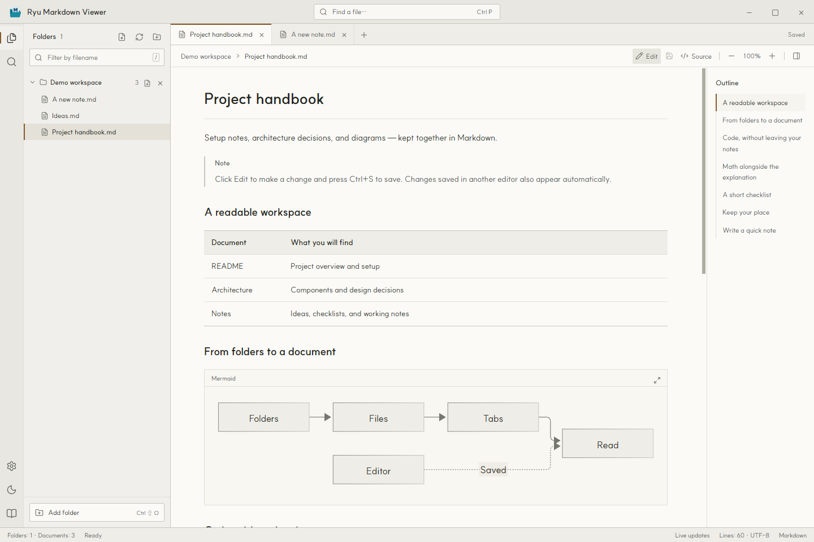
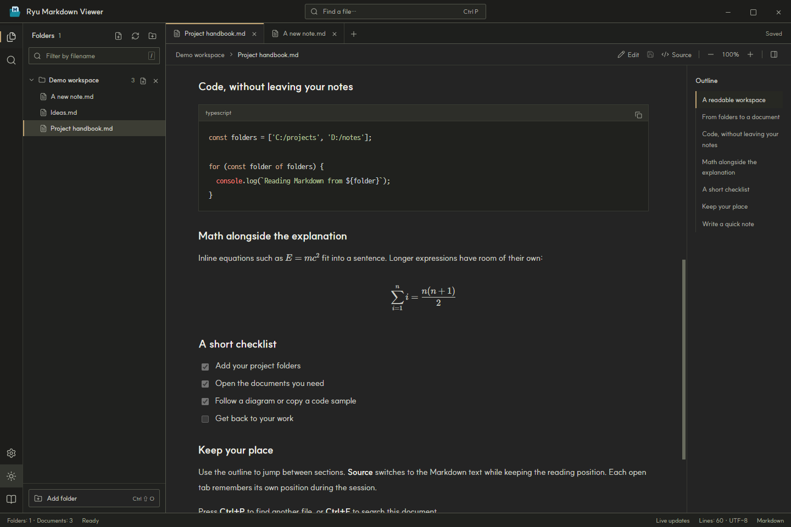
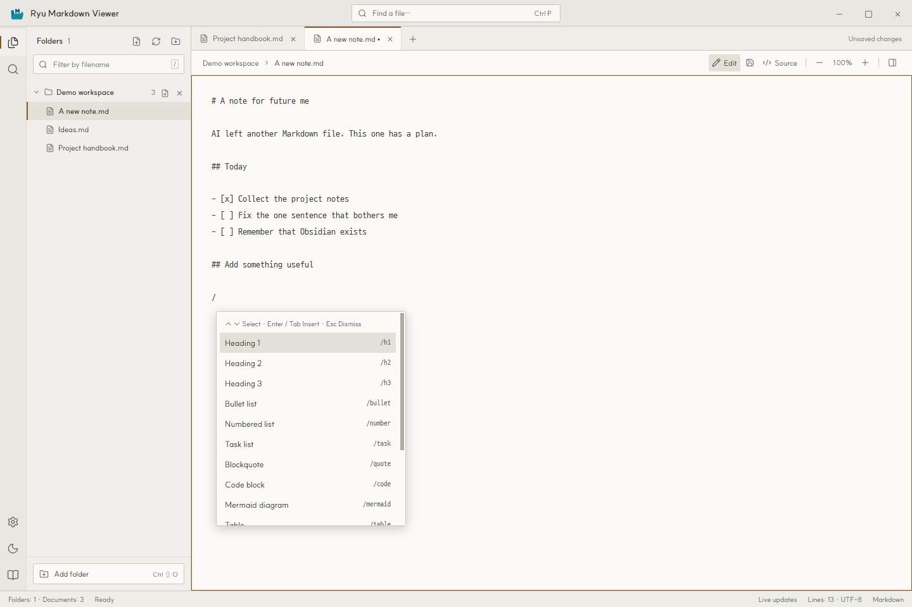
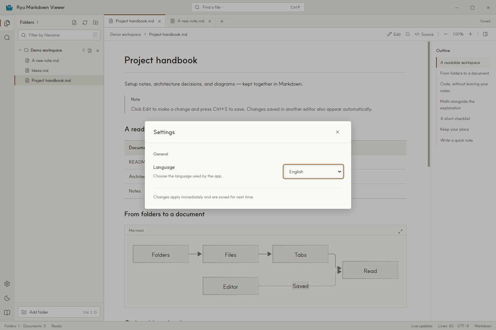

[English](README.md) · [한국어](README.ko.md) · **[日本語](README.ja.md)** · [简体中文](README.zh-Hans.md) · [繁體中文](README.zh-Hant.md)

# Ryu Markdown Viewer

複数のフォルダーにある Markdown 文書を、ひとつのウィンドウで読んで編集できる Windows アプリです。

## どうして作ったかというと

はい……AI にあれこれ頼んでいたら、Markdown ファイルがあちこちにたまってきました。ひとまとめにして、気軽に読むために作りました。

作り終わってから思い出しました。あ、Obsidian がありましたね……？

とはいえ、せっかく作ったので公開します。自分では、見た目もけっこう気に入っているんです。

**Windows 10/11 · x64 · MIT ライセンス**



## 主な機能

- アプリ内で Markdown を編集し、`Ctrl+S` で保存できます。フォルダー横の新規ファイルボタンや `Ctrl+N` で `.md` ファイルも作成できます。
- エディターで `/` を入力すると補完メニューが開きます。見出し、リスト、表、コードブロック、Mermaid などの Markdown テンプレートを挿入できます。
- 複数の場所にあるフォルダーを登録し、サブフォルダー内の `.md` と `.markdown` ファイルをまとめて表示します。
- タブと目次で文書を移動できます。`Ctrl+P` でファイルを探し、`Ctrl+F` で本文を検索できます。
- 表、タスクリスト、脚注、コードの構文強調、Mermaid の図、KaTeX の数式に対応しています。コードのコピーや図の拡大もできます。
- ソースとプレビューを切り替えても、読んでいた位置を保ちます。各タブの読書位置は、アプリを起動している間、それぞれ記憶されます。
- ライトテーマとダークテーマを選べます。登録フォルダー、開いているタブ、テーマ、ズーム、言語は再起動後も引き継がれます。
- 英語、韓国語、日本語、簡体字中国語、繁体字中国語に対応しています。ローカル文書はオフラインで読めます。

### ダークテーマでコードと数式を見る



## 読んで、その場で直す

1. **Edit** をクリックして、現在の文書を編集します。`Ctrl+S` で保存します。
2. フォルダー横の新規ファイルボタン、または `Ctrl+N` で文書を作成します。保存先とファイル名を選ぶと、そのままエディターで開きます。
3. エディターで `/` を入力してコマンドを選んでください。続けて入力すると候補を絞り込めます。クリックするか、↑/↓ で選んで Enter または Tab で挿入します。Esc で閉じます。



## ダウンロードと使い方

このリポジトリの **Releases** から Windows x64 版をダウンロードしてください。ポータブル EXE はインストール不要です。ZIP 版を使う場合は、すべてのファイルを展開してから、フォルダー内の `Ryu Markdown Viewer.exe` を起動してください。

| ダウンロード (v1.0.1 · Windows x64) | 起動方法 |
| --- | --- |
| [Portable (EXE)](https://github.com/hakrimryu/ryu-markdown-viewer/releases/download/v1.0.1/Ryu-Markdown-Viewer-1.0.1-Windows-x64-Portable.exe) | EXE ファイルひとつで起動できます。インストールは不要です。 |
| [ZIP](https://github.com/hakrimryu/ryu-markdown-viewer/releases/download/v1.0.1/Ryu-Markdown-Viewer-1.0.1-Windows-x64-ZIP.zip) | すべて展開してから `Ryu Markdown Viewer.exe` を起動します。 |

1. アプリを開き、左下の **Add folder** から文書フォルダーを登録します。初期表示は英語です。
2. 左の一覧から文書を選びます。別の場所にあるフォルダーも追加できます。
3. **編集**で文書を変更し、`Ctrl+S` で保存します。エディターで `/` を入力すると Markdown コマンドを選択できます。

フォルダー名の隣にある × は、登録を解除するボタンです。ファイルは削除されません。

## 言語の設定

左下の歯車をクリックし、**Language** から言語を選んでください。画面の表示と使い方ガイドがすぐに切り替わり、次回の起動時にも引き継がれます。文書自体の言語は変わりません。



## キーボードショートカット

| キー | 操作 |
| --- | --- |
| `Ctrl+N` | 新しい Markdown ファイル |
| `Ctrl+S` | 文書を保存 |
| `Ctrl+O` | ファイルを開く |
| `Ctrl+Shift+O` | フォルダーを追加 |
| `Ctrl+P` | ファイルを検索 |
| `Ctrl+F` | 本文を検索 |
| `Ctrl+B` | エクスプローラーを表示 / 非表示 |
| `Ctrl+W` | タブを閉じる |
| `Ctrl++` / `Ctrl+-` | 拡大 / 縮小 |
| `Ctrl+0` | 本文のズームを 100% に戻す |
| `/`（エディター） | Markdown の補完メニューを開く |
| `↑` / `↓` · `Enter` / `Tab` · `Esc`（補完メニュー） | 選択 · 挿入 · 閉じる |
| `/`（閲覧中） | ファイル名フィルターに移動 |

## ソースから実行する

Windows と Node.js 22.12 以降を使用します。リポジトリをダウンロードし、プロジェクトのフォルダーで実行してください。

```powershell
npm ci
npm run dev
```

画面をビルドしてアプリを起動するには、次のコマンドを使います。

```powershell
npm run build
npm start
```

配布用の Portable EXE と ZIP は、次のコマンドで作成します。出力先は `release/` です。

```powershell
npm run dist
```

画面をビルドした後にチェックを実行できます。

```powershell
npm test
npm run test:app
npm run test:settings
npm run test:editing
```

Electron、Vite、Markdown-it、Mermaid、KaTeX を使用しています。[英語のサンプル](examples/README.en.md)と[韓国語のサンプル](examples/README.md)を用意しています。README のスクリーンショットは、実際のアプリを英語で起動して撮影したものです。

## 対応範囲と制限

- 未保存の内容はアプリ実行中のメモリに保持されます。タブを閉じる、フォルダーを解除する、アプリを終了する際は保存を確認します。外部で変更されたファイルの上書きは防止されます。
- Markdown ファイルは 20 MB、ローカル画像は 30 MB まで読み込めます。ローカル画像と相対リンクの文書は、登録したフォルダー内にある必要があります。
- `.git`、`node_modules`、`.svn`、`.hg`、シンボリックリンク、ジャンクションは探索対象に含みません。
- MDX、JavaScript、リモート include、PlantUML、Graphviz は実行しません。HTML はサニタイズしてから表示します。
- HTTPS 画像や外部リンクにはインターネット接続が必要です。ネットワークドライブの変更が反映されない場合は、更新ボタンを押してください。
- 配布 EXE にはコード署名がないため、Windows SmartScreen の確認画面が表示されることがあります。

以前のバージョンとの互換性を保つため、設定は `%APPDATA%/Markdesk/workspace.json` に保存します。

## 不具合の報告と貢献

不具合があれば、アプリのバージョン、Windows のバージョン、再現手順を Issues に記載してください。特定の文書で起きる場合は、個人情報を除いた短いサンプルがあると確認しやすくなります。修正の提案はプルリクエストでお送りください。

## ライセンス

Copyright (c) 2026 HakrimRyu。[MIT ライセンス](LICENSE)で公開しています。

同梱フォントには元のライセンスが適用されます。[SUIT](assets/fonts/SUIT-LICENSE.txt) と [D2Coding](assets/fonts/D2Coding-LICENSE.txt) のライセンスを同梱しています。外部ライブラリにも、それぞれのライセンスが適用されます。
