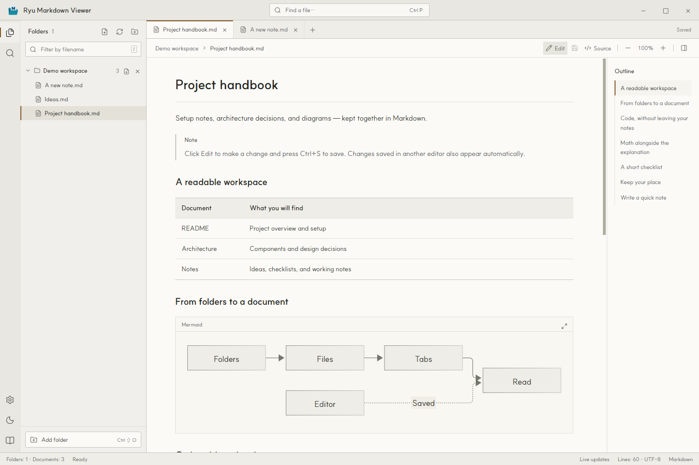
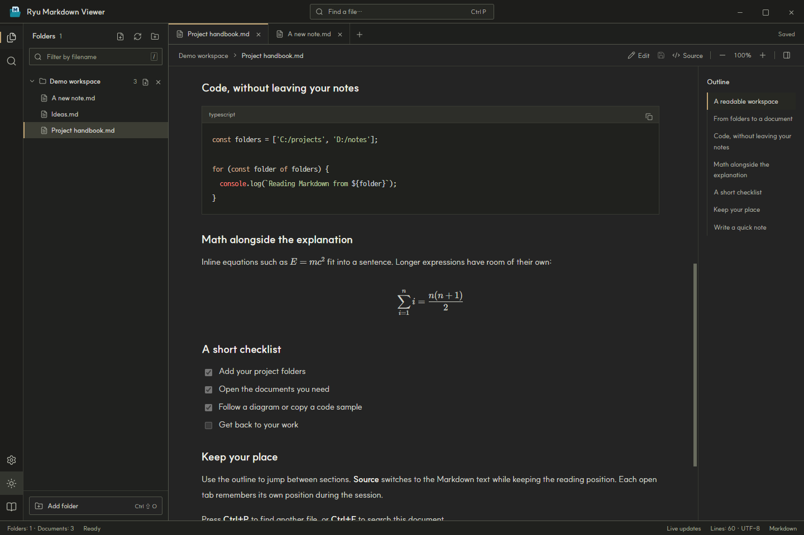
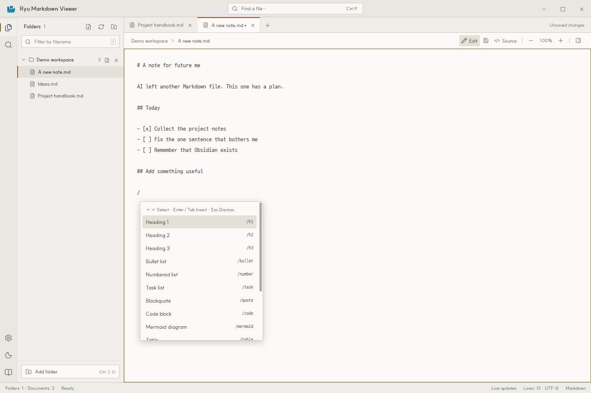
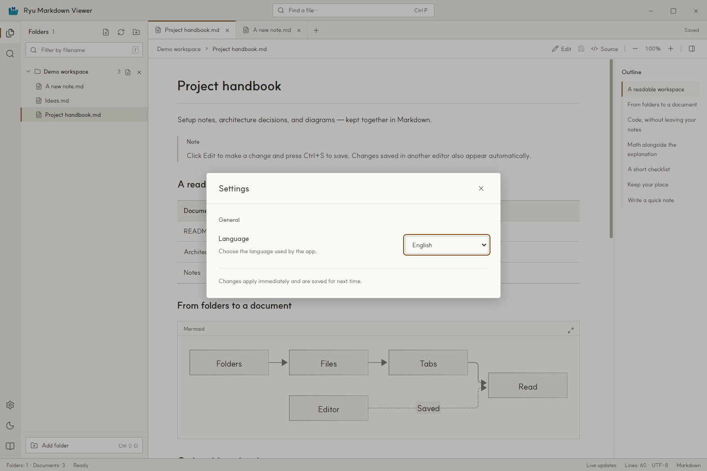

[English](README.md) · **[한국어](README.ko.md)** · [日本語](README.ja.md) · [简体中文](README.zh-Hans.md) · [繁體中文](README.zh-Hant.md)

# Ryu Markdown Viewer

여러 폴더의 Markdown 문서를 한 창에서 읽고 고치는 Windows 앱입니다.

## 어쩌다 만들었냐면

네… AI한테 이것저것 시키다 보니 Markdown 파일이 여기저기 쌓였습니다. 한곳에 모아서 가볍게 읽으려고 만들었습니다.

다 만들고 나서야 생각났습니다. 아, 옵시디언이 있었죠…?

그래도 만든 김에 공유합니다. 제 눈에는 꽤 예쁘거든요.

**Windows 10/11 · x64 · MIT 라이선스**



## 주요 기능

- 앱 안에서 Markdown을 편집하고 `Ctrl+S`로 저장합니다. 폴더 옆 새 파일 버튼이나 `Ctrl+N`으로 `.md` 파일도 만들 수 있습니다.
- 편집창에서 `/`를 입력하면 자동완성 드롭다운이 열립니다. 제목, 목록, 표, 코드 블록, Mermaid 같은 Markdown 틀을 골라 넣습니다.
- 여러 경로의 폴더를 등록하면 하위 폴더의 `.md`, `.markdown` 파일을 모아 보여줍니다.
- 탭과 목차로 문서를 오가고 `Ctrl+P`로 파일을 찾거나 `Ctrl+F`로 본문을 검색합니다.
- 표, 체크리스트, 각주, 코드 구문 강조, Mermaid 다이어그램, KaTeX 수식을 표시합니다. 코드 복사와 다이어그램 확대도 지원합니다.
- 원문과 미리보기를 전환할 때 읽던 위치를 유지합니다. 열린 탭마다 읽기 위치를 기억하는 기능은 현재 실행 중인 앱에서 동작합니다.
- 밝은 테마와 어두운 테마를 지원합니다. 폴더, 열린 탭, 테마, 확대 비율, 언어 설정은 앱을 다시 켜도 유지됩니다.
- 영어, 한국어, 일본어, 중국어 간체와 번체를 지원합니다. 로컬 문서를 읽는 데는 인터넷 연결이 필요하지 않습니다.

### 어두운 테마에서 코드와 수식 보기



## 읽다가 바로 고치기

1. **Edit**를 누르면 현재 문서를 편집할 수 있습니다. 수정한 내용은 `Ctrl+S`로 저장합니다.
2. 새 문서는 폴더 옆 새 파일 버튼이나 `Ctrl+N`으로 만듭니다. 저장 위치와 이름을 고르면 바로 편집창이 열립니다.
3. 편집창에서 `/`를 입력하고 명령어를 고르세요. 이어서 입력하면 목록이 좁혀집니다. 마우스로 클릭하거나 ↑/↓로 이동한 뒤 Enter 또는 Tab으로 넣습니다. Esc로 닫을 수 있습니다.



## 다운로드와 실행

이 저장소의 **Releases**에서 Windows x64 배포본을 내려받으세요. 포터블 EXE는 설치 없이 실행합니다. ZIP 배포본을 사용한다면 압축을 모두 푼 뒤 폴더 안의 `Ryu Markdown Viewer.exe`를 실행하세요.

| 다운로드 (v1.0.1 · Windows x64) | 실행 방법 |
| --- | --- |
| [Portable (EXE)](https://github.com/hakrimryu/ryu-markdown-viewer/releases/download/v1.0.1/Ryu-Markdown-Viewer-1.0.1-Windows-x64-Portable.exe) | EXE 파일 하나로 실행합니다. 설치는 필요 없습니다. |
| [ZIP](https://github.com/hakrimryu/ryu-markdown-viewer/releases/download/v1.0.1/Ryu-Markdown-Viewer-1.0.1-Windows-x64-ZIP.zip) | 압축을 모두 푼 뒤 `Ryu Markdown Viewer.exe`를 실행합니다. |

1. 앱을 실행한 뒤 왼쪽 아래 **Add folder**를 눌러 문서 폴더를 등록합니다. 기본 화면은 영어입니다.
2. 왼쪽 목록에서 문서를 선택합니다. 다른 경로에 있는 폴더도 추가할 수 있습니다.
3. **편집**을 눌러 내용을 수정하고 `Ctrl+S`로 저장하세요. 편집창에서 `/`를 입력하면 Markdown 명령어를 선택할 수 있습니다.

폴더 이름 옆의 × 버튼은 등록만 해제합니다. 실제 파일은 삭제하지 않습니다.

## 언어 설정

왼쪽 아래 기어 버튼을 누르고 **Language**에서 언어를 선택하세요. 화면 문구와 사용 안내가 바로 바뀌며 다음 실행에도 선택한 언어로 열립니다. 문서 자체의 언어는 바뀌지 않습니다.



## 단축키

| 단축키 | 동작 |
| --- | --- |
| `Ctrl+N` | 새 Markdown 파일 |
| `Ctrl+S` | 문서 저장 |
| `Ctrl+O` | 파일 열기 |
| `Ctrl+Shift+O` | 폴더 추가 |
| `Ctrl+P` | 파일 찾기 |
| `Ctrl+F` | 본문 검색 |
| `Ctrl+B` | 탐색기 표시 / 숨기기 |
| `Ctrl+W` | 탭 닫기 |
| `Ctrl++` / `Ctrl+-` | 본문 확대 / 축소 |
| `Ctrl+0` | 본문 배율 100% |
| `/` (편집창) | Markdown 자동완성 열기 |
| `↑` / `↓` · `Enter` / `Tab` · `Esc` (자동완성) | 선택 이동 · 삽입 · 닫기 |
| `/` (문서 읽는 중) | 파일명 필터로 이동 |

## 소스에서 실행하기

Windows에서 Node.js 22.12 이상을 사용합니다. 저장소를 내려받은 뒤 프로젝트 폴더에서 실행하세요.

```powershell
npm ci
npm run dev
```

화면을 빌드하고 앱을 실행하려면 다음 명령을 사용합니다.

```powershell
npm run build
npm start
```

배포용 Portable EXE와 ZIP은 다음 명령으로 만듭니다. 결과 파일은 `release/`에 생깁니다.

```powershell
npm run dist
```

검사는 화면을 빌드한 뒤 실행합니다.

```powershell
npm test
npm run test:app
npm run test:settings
npm run test:editing
```

Electron, Vite, Markdown-it, Mermaid, KaTeX로 만들었습니다. 예제는 [examples/README.en.md](examples/README.en.md)와 [examples/README.md](examples/README.md)에 있습니다. README의 스크린샷은 실제 앱을 영어로 실행해 촬영했습니다.

## 알아둘 점

- 저장 전 편집 내용은 앱 실행 중 메모리에 유지됩니다. 탭 닫기·폴더 등록 해제·앱 종료 시 저장 여부를 확인합니다. 외부에서 바뀐 파일은 실수로 덮어쓰지 않도록 저장을 중단합니다.
- Markdown 파일은 20 MB, 로컬 이미지는 30 MB까지 읽습니다. 로컬 이미지와 상대 문서 링크는 등록한 폴더 안에서만 열립니다.
- `.git`, `node_modules`, `.svn`, `.hg`, 심볼릭 링크와 정션은 탐색에서 제외합니다.
- MDX, JavaScript, 원격 include, PlantUML, Graphviz는 실행하지 않습니다. HTML은 정화한 뒤 표시합니다.
- HTTPS 이미지와 외부 링크를 열려면 인터넷 연결이 필요합니다. 네트워크 드라이브의 변경이 바로 반영되지 않으면 새로고침 버튼을 눌러주세요.
- 배포 EXE는 코드 서명하지 않았으므로 Windows SmartScreen 확인 화면이 나타날 수 있습니다.

설정은 기존 버전과의 호환을 위해 `%APPDATA%/Markdesk/workspace.json`에 저장합니다.

## 버그 제보와 기여

문제가 생기면 Issues에 앱 버전, Windows 버전, 재현 순서를 남겨주세요. 특정 문서에서만 생기는 문제라면 개인정보를 지운 짧은 예제를 함께 올려주시면 확인하기 쉽습니다. 수정 제안은 Pull Request로 보내주세요.

## 라이선스

Copyright (c) 2026 HakrimRyu. [MIT 라이선스](LICENSE)로 공개합니다.

앱에 포함된 폰트는 원본 라이선스를 따릅니다. [SUIT 라이선스](assets/fonts/SUIT-LICENSE.txt)와 [D2Coding 라이선스](assets/fonts/D2Coding-LICENSE.txt)를 함께 제공합니다. 외부 라이브러리에도 각각의 라이선스가 적용됩니다.
