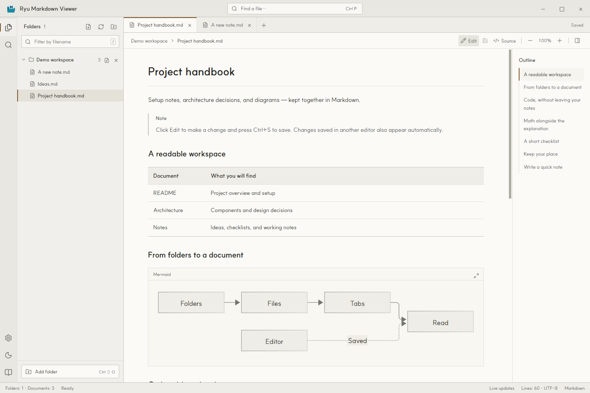
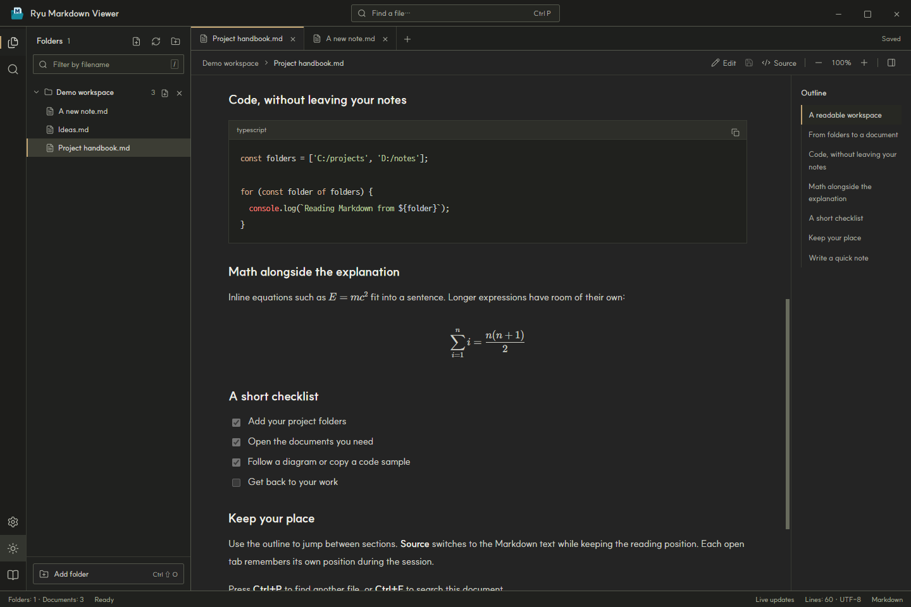
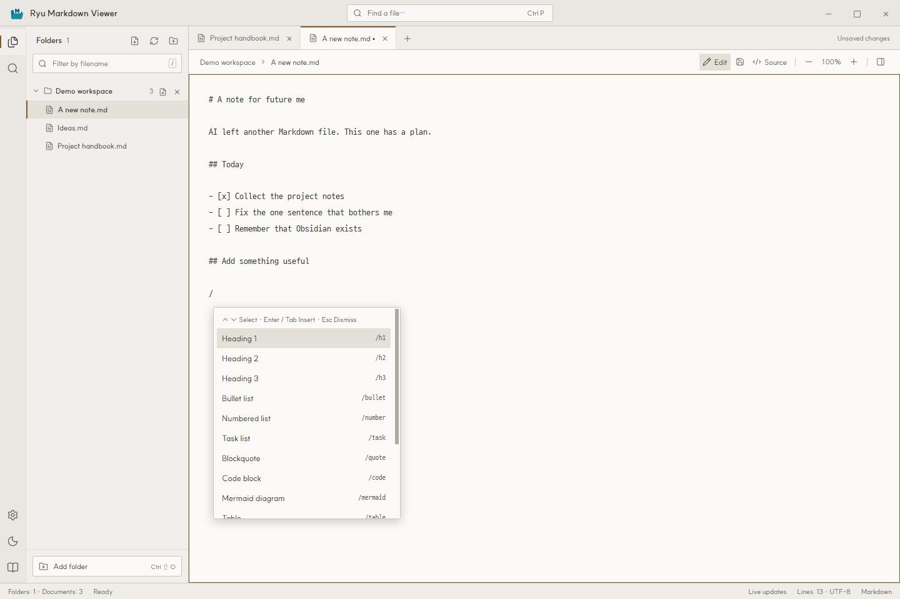
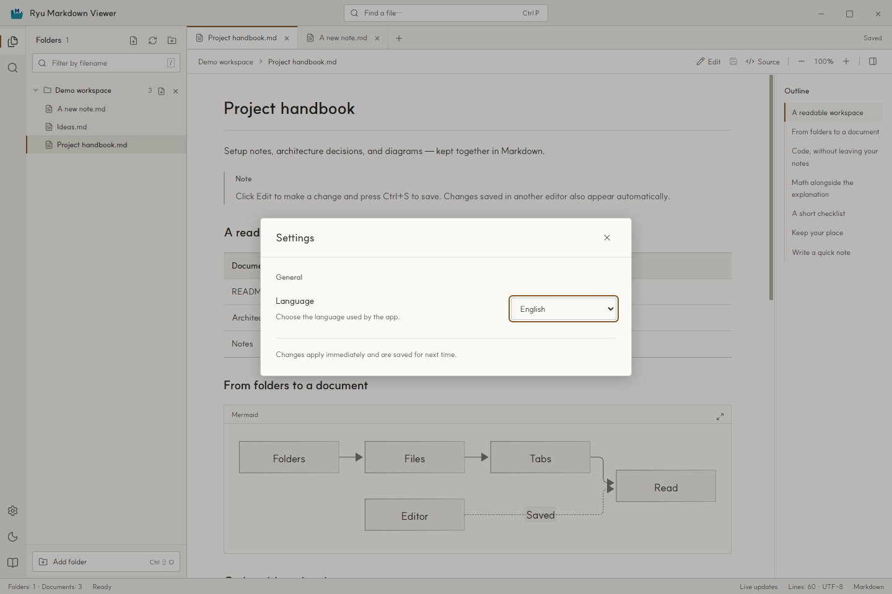

**[English](README.md)** · [한국어](README.ko.md) · [日本語](README.ja.md) · [简体中文](README.zh-Hans.md) · [繁體中文](README.zh-Hant.md)

# Ryu Markdown Viewer

A Windows app for reading and editing Markdown across multiple folders.

## Why this exists

Well… I kept asking AI to do things, and Markdown files kept turning up all over my folders. I made this to gather them in one place and give them a quick read.

Only after finishing it did I remember Obsidian exists. Great timing.

Still, it's already made, and I think it looks pretty. So I'm sharing it.

**Windows 10/11 · x64 · MIT licensed**



## Features

- Edit Markdown in the app and save with `Ctrl+S`. Create `.md` files with the folder’s new-file button or `Ctrl+N`.
- Type `/` in the editor to open a completion dropdown. Insert headings, lists, tables, code blocks, Mermaid diagrams, and other Markdown snippets.
- Add folders from different locations and browse their `.md` and `.markdown` files, including subfolders.
- Navigate with tabs and an outline. Use `Ctrl+P` to find a file or `Ctrl+F` to search the current document.
- Read tables, task lists, footnotes, highlighted code, Mermaid diagrams, and KaTeX equations. Copy code or open diagrams in a larger view.
- Keep your place when switching between source and preview. Each open tab remembers its reading position during the session.
- Switch between light and dark themes. Folders, tabs, theme, zoom, and language are restored after restarting.
- Choose English, Korean, Japanese, Simplified Chinese, or Traditional Chinese. Local documents work offline.

### Code and equations in the dark theme



## Read it, then fix it

1. Click **Edit** to change the current document. Press `Ctrl+S` to save.
2. Use the new-file button beside a folder, or press `Ctrl+N`. Choose a location and filename, and the new document opens in the editor.
3. Type `/` in the editor and choose a command. Keep typing to narrow the list. Click an item, or use ↑/↓ followed by Enter or Tab to insert it. Esc dismisses the dropdown.



## Download and get started

Download a Windows x64 build from this repository's **Releases** page. The portable EXE runs without an installer. If you use a ZIP build, extract the entire archive, then run `Ryu Markdown Viewer.exe` inside it.

| Download (v1.0.1 · Windows x64) | How to run |
| --- | --- |
| [Portable (EXE)](https://github.com/hakrimryu/ryu-markdown-viewer/releases/download/v1.0.1/Ryu-Markdown-Viewer-1.0.1-Windows-x64-Portable.exe) | Run the single EXE; no installer needed. |
| [ZIP](https://github.com/hakrimryu/ryu-markdown-viewer/releases/download/v1.0.1/Ryu-Markdown-Viewer-1.0.1-Windows-x64-ZIP.zip) | Extract the entire archive, then run `Ryu Markdown Viewer.exe`. |

1. Open the app and click **Add folder** at the bottom left. English is the default language.
2. Select a document in the explorer. Add more folders as needed, even when they live in different locations.
3. Click **Edit**, change the document, and press `Ctrl+S` to save. Type `/` in the editor for Markdown commands.

The × button next to a folder removes it from the workspace. It does not delete files.

## Language settings

Click the gear at the bottom left and choose a **Language**. The interface and built-in guide change immediately, and your choice is remembered after restarting. Documents retain their original language.



## Keyboard shortcuts

| Shortcut | Action |
| --- | --- |
| `Ctrl+N` | New Markdown file |
| `Ctrl+S` | Save document |
| `Ctrl+O` | Open a file |
| `Ctrl+Shift+O` | Add a folder |
| `Ctrl+P` | Find a file |
| `Ctrl+F` | Find in the current document |
| `Ctrl+B` | Show / hide the explorer |
| `Ctrl+W` | Close a tab |
| `Ctrl++` / `Ctrl+-` | Zoom in / out |
| `Ctrl+0` | Reset document zoom to 100% |
| `/` (editor) | Open Markdown completion |
| `↑` / `↓` · `Enter` / `Tab` · `Esc` (completion) | Select · insert · dismiss |
| `/` (reading) | Focus the filename filter |

## Run from source

Use Windows with Node.js 22.12 or later. Download the repository and run these commands from its folder:

```powershell
npm ci
npm run dev
```

To build the interface and start the app:

```powershell
npm run build
npm start
```

To create Portable EXE and ZIP builds in `release/`:

```powershell
npm run dist
```

Run the checks after building the interface:

```powershell
npm test
npm run test:app
npm run test:settings
npm run test:editing
```

Built with Electron, Vite, Markdown-it, Mermaid, and KaTeX. Try the [English example](examples/README.en.md) or the [Korean example](examples/README.md). README screenshots were captured from the actual app running in English.

## Scope and limits

- Unsaved edits stay in memory while the app is running. Closing a tab, removing a folder, or quitting asks whether to save them. Files changed externally are protected from accidental overwrites.
- Markdown files can be up to 20 MB; local images can be up to 30 MB. Local images and relative document links must stay inside added folders.
- `.git`, `node_modules`, `.svn`, `.hg`, symbolic links, and junctions are excluded from browsing.
- MDX, JavaScript, remote includes, PlantUML, and Graphviz are not executed. HTML is sanitized before display.
- HTTPS images and external links need an internet connection. If changes on a network drive do not appear, use Refresh.
- Release executables are unsigned, so Windows SmartScreen may show a confirmation screen.

Settings remain at `%APPDATA%/Markdesk/workspace.json` for compatibility with earlier versions.

## Bugs and contributions

Open an issue with the app version, Windows version, and steps to reproduce the problem. For a document-specific issue, a short sample with personal information removed helps. Fixes and improvements are welcome as pull requests.

## License

Copyright (c) 2026 HakrimRyu. Released under the [MIT License](LICENSE).

Bundled fonts keep their original licenses: [SUIT](assets/fonts/SUIT-LICENSE.txt) and [D2Coding](assets/fonts/D2Coding-LICENSE.txt). Third-party libraries are covered by their respective licenses.
