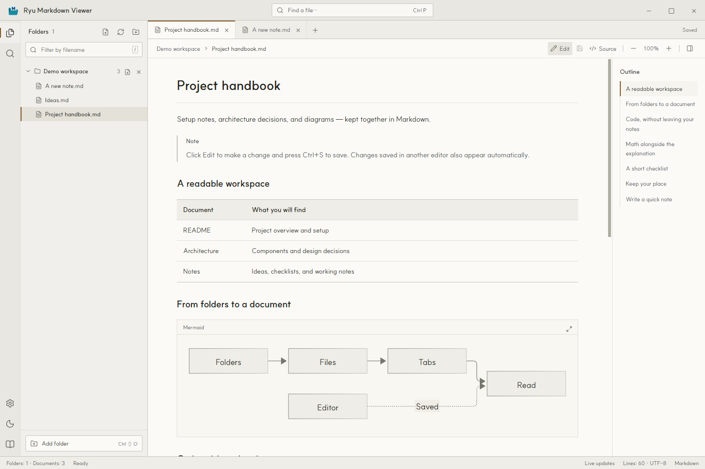
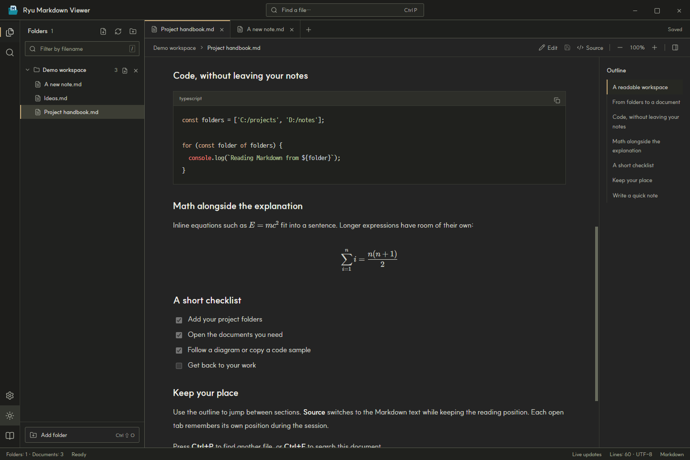
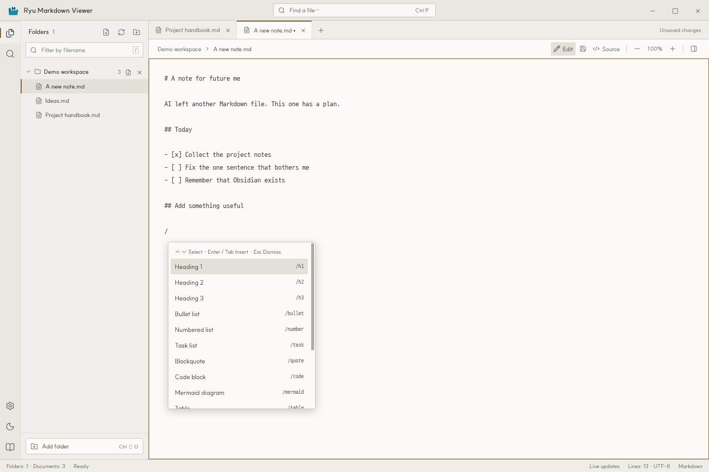
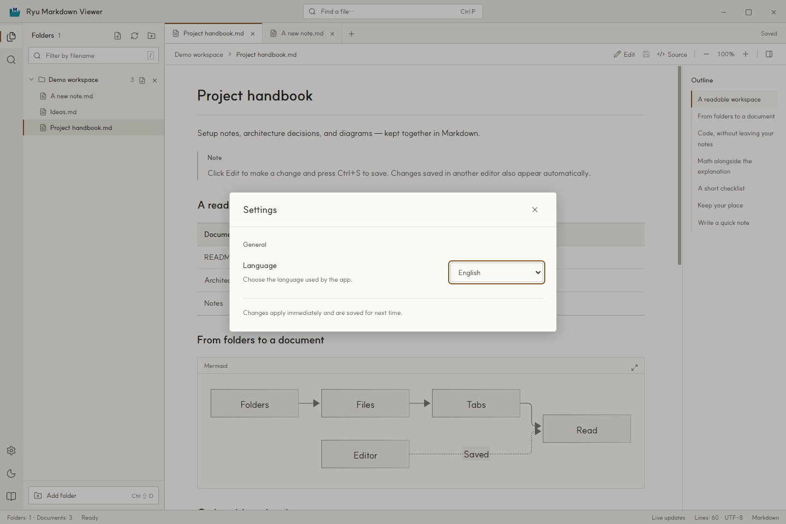

[English](README.md) · [한국어](README.ko.md) · [日本語](README.ja.md) · **[简体中文](README.zh-Hans.md)** · [繁體中文](README.zh-Hant.md)

# Ryu Markdown Viewer

一款 Windows 应用，把多个文件夹里的 Markdown 文档放在同一个窗口中阅读和编辑。

## 怎么就做了这么个东西

嗯……让 AI 帮忙做了些事情之后，Markdown 文件就散落得到处都是。于是做了这个应用，想把它们放在一起，轻松翻翻。

做完才想起来：啊，原来还有 Obsidian。想起来的时机真好。

不过，既然都做出来了，我自己看着也觉得挺好看，那就分享出来吧。

**Windows 10/11 · x64 · MIT 许可证**



## 主要功能

- 在应用内编辑 Markdown，按 `Ctrl+S` 保存。使用文件夹旁的新建文件按钮或 `Ctrl+N` 创建 `.md` 文件。
- 在编辑器中输入 `/`，打开自动补全下拉列表，插入标题、列表、表格、代码块、Mermaid 图表等 Markdown 模板。
- 添加不同位置的文件夹，浏览其中及子文件夹里的 `.md` 和 `.markdown` 文件。
- 通过标签页和大纲浏览文档。按 `Ctrl+P` 查找文件，按 `Ctrl+F` 搜索当前文档。
- 显示表格、任务列表、脚注、代码高亮、Mermaid 图表和 KaTeX 公式。支持复制代码和放大图表。
- 在源代码与预览之间切换时保留阅读位置。应用运行期间，每个打开的标签页分别记住自己的阅读位置。
- 提供浅色和深色主题。重启后会恢复文件夹、标签页、主题、缩放比例和语言设置。
- 支持英语、韩语、日语、简体中文和繁体中文。阅读本地文档不需要联网。

### 查看深色主题下的代码和公式



## 读到哪里，改到哪里

1. 点击 **Edit** 编辑当前文档，按 `Ctrl+S` 保存。
2. 点击文件夹旁的新建文件按钮，或按 `Ctrl+N`。选择位置和文件名后，新文档会直接在编辑器中打开。
3. 在编辑器中输入 `/` 选择命令。继续输入可以筛选列表。点击条目，或用 ↑/↓ 选择后按 Enter 或 Tab 插入。按 Esc 关闭列表。



## 下载与使用

从本仓库的 **Releases** 页面下载 Windows x64 版本。便携 EXE 无需安装即可运行。如果使用 ZIP 版本，请完整解压后，再运行文件夹内的 `Ryu Markdown Viewer.exe`。

| 下载 (v1.0.0 · Windows x64) | 运行方法 |
| --- | --- |
| [Portable (EXE)](https://github.com/hakrimryu/ryu-markdown-viewer/releases/download/v1.0.0/Ryu-Markdown-Viewer-1.0.0-Windows-x64-Portable.exe) | 直接运行单个 EXE，无需安装。 |
| [ZIP](https://github.com/hakrimryu/ryu-markdown-viewer/releases/download/v1.0.0/Ryu-Markdown-Viewer-1.0.0-Windows-x64-ZIP.zip) | 完整解压后运行 `Ryu Markdown Viewer.exe`。 |

1. 打开应用，点击左下角的 **Add folder** 添加文档文件夹。默认界面语言为英语。
2. 从左侧列表选择文档。也可以继续添加位于其他路径的文件夹。
3. 点击**编辑**修改文档，按 `Ctrl+S` 保存。在编辑器输入 `/` 即可选择 Markdown 命令。

文件夹名称旁的 × 只会将其从工作区移除，不会删除文件。

## 语言设置

点击左下角的齿轮，在 **Language** 中选择语言。界面文字和内置指南会立即切换，重启后仍会保留。文档本身的语言不会改变。



## 快捷键

| 快捷键 | 操作 |
| --- | --- |
| `Ctrl+N` | 新建 Markdown 文件 |
| `Ctrl+S` | 保存文档 |
| `Ctrl+O` | 打开文件 |
| `Ctrl+Shift+O` | 添加文件夹 |
| `Ctrl+P` | 查找文件 |
| `Ctrl+F` | 搜索当前文档 |
| `Ctrl+B` | 显示 / 隐藏资源管理器 |
| `Ctrl+W` | 关闭标签页 |
| `Ctrl++` / `Ctrl+-` | 放大 / 缩小正文 |
| `Ctrl+0` | 将正文缩放恢复为 100% |
| `/`（编辑器） | 打开 Markdown 自动补全 |
| `↑` / `↓` · `Enter` / `Tab` · `Esc`（自动补全） | 选择 · 插入 · 关闭 |
| `/`（阅读时） | 聚焦文件名筛选框 |

## 从源码运行

需要 Windows 和 Node.js 22.12 或更高版本。下载仓库后，在项目目录中运行：

```powershell
npm ci
npm run dev
```

构建界面并启动应用：

```powershell
npm run build
npm start
```

生成用于分发的 Portable EXE 和 ZIP，输出目录为 `release/`：

```powershell
npm run dist
```

构建界面后运行检查：

```powershell
npm test
npm run test:app
npm run test:settings
npm run test:editing
```

使用 Electron、Vite、Markdown-it、Mermaid 和 KaTeX 开发。可以试读[英文示例](examples/README.en.md)或[韩文示例](examples/README.md)。README 中的截图均来自实际运行的英文版应用。

## 支持范围与限制

- 未保存的内容在应用运行期间保留在内存中。关闭标签页、移除文件夹或退出时会询问是否保存。外部修改的文件会受到保护，避免意外覆盖。
- Markdown 文件最大为 20 MB，本地图片最大为 30 MB。本地图片和相对文档链接必须位于已添加的文件夹内。
- 浏览时会排除 `.git`、`node_modules`、`.svn`、`.hg`、符号链接和目录联接。
- 不执行 MDX、JavaScript、远程 include、PlantUML 或 Graphviz。HTML 会经过净化处理后显示。
- HTTPS 图片和外部链接需要联网。如果网络驱动器中的更改未显示，请点击刷新按钮。
- 发布的 EXE 未进行代码签名，Windows SmartScreen 可能会显示确认提示。

为兼容早期版本，设置仍保存在 `%APPDATA%/Markdesk/workspace.json`。

## 问题反馈与贡献

请在 Issues 中注明应用版本、Windows 版本和复现步骤。如果问题只出现在某个文档中，请尽量附上删除个人信息后的简短示例。代码修复和改进建议可以通过 Pull Request 提交。

## 许可证

Copyright (c) 2026 HakrimRyu。项目采用 [MIT 许可证](LICENSE)。

附带字体保留各自的原始许可证：[SUIT](assets/fonts/SUIT-LICENSE.txt) 和 [D2Coding](assets/fonts/D2Coding-LICENSE.txt)。第三方库适用各自的许可证。
