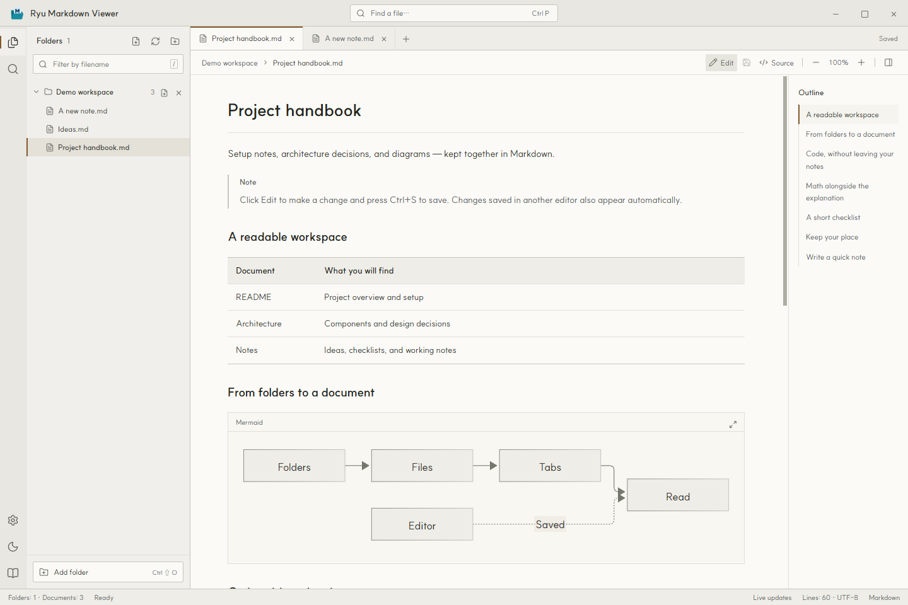
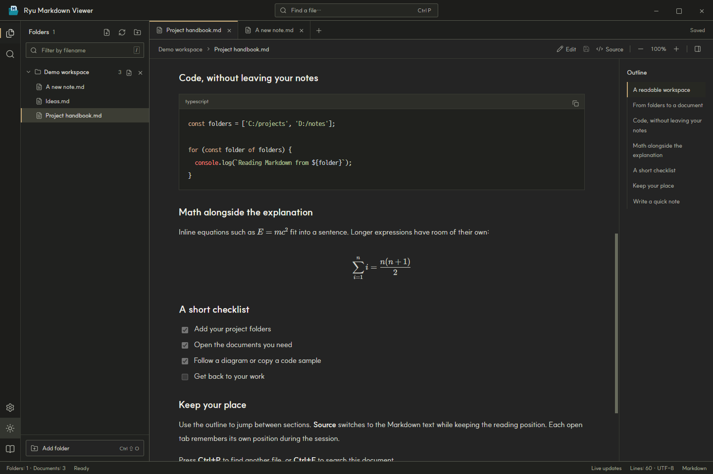
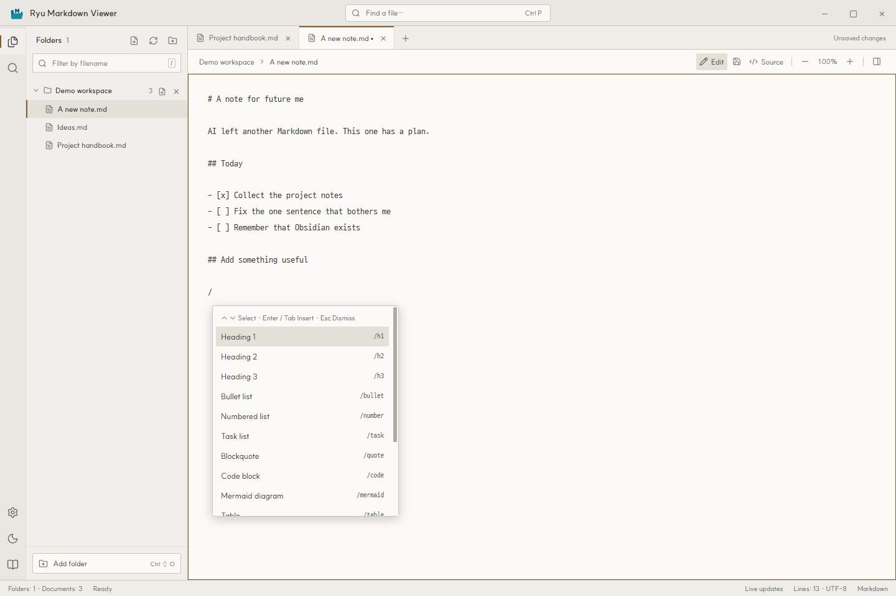
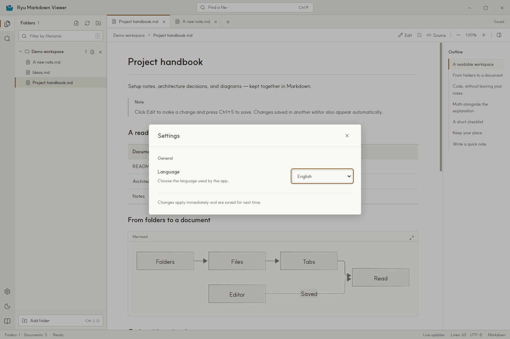

[English](README.md) · [한국어](README.ko.md) · [日本語](README.ja.md) · [简体中文](README.zh-Hans.md) · **[繁體中文](README.zh-Hant.md)**

# Ryu Markdown Viewer

一款 Windows 應用程式，把多個資料夾裡的 Markdown 文件放在同一個視窗中閱讀和編輯。

## 怎麼就做了這個東西

嗯……請 AI 幫忙做了些事情之後，Markdown 檔案就散落得到處都是。於是做了這個應用程式，想把它們放在一起，輕鬆翻翻。

做完才想起來：啊，原來還有 Obsidian。想起來的時機真好。

不過，既然都做出來了，我自己看著也覺得滿好看的，就拿出來分享吧。

**Windows 10/11 · x64 · MIT 授權**



## 主要功能

- 在應用程式內編輯 Markdown，按 `Ctrl+S` 儲存。使用資料夾旁的新增檔案按鈕或 `Ctrl+N` 建立 `.md` 檔案。
- 在編輯器中輸入 `/`，開啟自動完成下拉清單，插入標題、清單、表格、程式碼區塊、Mermaid 圖表等 Markdown 範本。
- 新增不同位置的資料夾，瀏覽其中及子資料夾內的 `.md` 和 `.markdown` 檔案。
- 透過分頁和大綱瀏覽文件。按 `Ctrl+P` 尋找檔案，按 `Ctrl+F` 搜尋目前的文件。
- 顯示表格、工作清單、註腳、程式碼語法醒目提示、Mermaid 圖表和 KaTeX 公式。支援複製程式碼與放大圖表。
- 在原始碼和預覽之間切換時保留閱讀位置。應用程式執行期間，每個開啟的分頁會分別記住閱讀位置。
- 提供淺色與深色主題。重新啟動後會還原資料夾、分頁、主題、縮放比例和語言設定。
- 支援英語、韓語、日語、簡體中文和繁體中文。閱讀本機文件不需要連線。

### 查看深色主題下的程式碼與公式



## 讀到哪裡，改到哪裡

1. 點選 **Edit** 編輯目前的文件，按 `Ctrl+S` 儲存。
2. 點選資料夾旁的新增檔案按鈕，或按 `Ctrl+N`。選擇位置和檔名後，新文件會直接在編輯器中開啟。
3. 在編輯器中輸入 `/` 選擇指令。繼續輸入可以篩選清單。點選項目，或用 ↑/↓ 選擇後按 Enter 或 Tab 插入。按 Esc 關閉清單。



## 下載與使用

從本儲存庫的 **Releases** 頁面下載 Windows x64 版本。可攜式 EXE 不需安裝即可執行。如果使用 ZIP 版本，請先完整解壓縮，再執行資料夾內的 `Ryu Markdown Viewer.exe`。

| 下載 (v1.0.1 · Windows x64) | 執行方式 |
| --- | --- |
| [Portable (EXE)](https://github.com/hakrimryu/ryu-markdown-viewer/releases/download/v1.0.1/Ryu-Markdown-Viewer-1.0.1-Windows-x64-Portable.exe) | 直接執行單一 EXE，不需安裝。 |
| [ZIP](https://github.com/hakrimryu/ryu-markdown-viewer/releases/download/v1.0.1/Ryu-Markdown-Viewer-1.0.1-Windows-x64-ZIP.zip) | 完整解壓縮後執行 `Ryu Markdown Viewer.exe`。 |

1. 開啟應用程式，點選左下角的 **Add folder** 新增文件資料夾。預設介面語言為英語。
2. 從左側清單選擇文件。也可以繼續新增位於其他路徑的資料夾。
3. 點選**編輯**修改文件，按 `Ctrl+S` 儲存。在編輯器輸入 `/` 即可選擇 Markdown 指令。

資料夾名稱旁的 × 只會將其從工作區移除，不會刪除檔案。

## 語言設定

點選左下角的齒輪，在 **Language** 中選擇語言。介面文字和內建指南會立即切換，重新啟動後仍會保留。文件本身的語言不會改變。



## 快速鍵

| 快速鍵 | 操作 |
| --- | --- |
| `Ctrl+N` | 新增 Markdown 檔案 |
| `Ctrl+S` | 儲存文件 |
| `Ctrl+O` | 開啟檔案 |
| `Ctrl+Shift+O` | 新增資料夾 |
| `Ctrl+P` | 尋找檔案 |
| `Ctrl+F` | 搜尋目前的文件 |
| `Ctrl+B` | 顯示 / 隱藏檔案總管 |
| `Ctrl+W` | 關閉分頁 |
| `Ctrl++` / `Ctrl+-` | 放大 / 縮小內文 |
| `Ctrl+0` | 將內文縮放還原為 100% |
| `/`（編輯器） | 開啟 Markdown 自動完成 |
| `↑` / `↓` · `Enter` / `Tab` · `Esc`（自動完成） | 選擇 · 插入 · 關閉 |
| `/`（閱讀時） | 移至檔案名稱篩選框 |

## 從原始碼執行

需要 Windows 和 Node.js 22.12 或更新版本。下載儲存庫後，在專案目錄中執行：

```powershell
npm ci
npm run dev
```

建置介面並啟動應用程式：

```powershell
npm run build
npm start
```

產生供散布的 Portable EXE 和 ZIP，輸出目錄為 `release/`：

```powershell
npm run dist
```

建置介面後執行檢查：

```powershell
npm test
npm run test:app
npm run test:settings
npm run test:editing
```

使用 Electron、Vite、Markdown-it、Mermaid 和 KaTeX 開發。可以試讀[英文範例](examples/README.en.md)或[韓文範例](examples/README.md)。README 中的螢幕擷取畫面均來自實際執行的英文版應用程式。

## 支援範圍與限制

- 尚未儲存的內容在應用程式執行期間保留在記憶體中。關閉分頁、移除資料夾或結束時會詢問是否儲存。外部修改的檔案會受到保護，避免意外覆寫。
- Markdown 檔案最大為 20 MB，本機圖片最大為 30 MB。本機圖片和相對文件連結必須位於已新增的資料夾內。
- 瀏覽時會排除 `.git`、`node_modules`、`.svn`、`.hg`、符號連結和目錄連接。
- 不執行 MDX、JavaScript、遠端 include、PlantUML 或 Graphviz。HTML 會先經過淨化處理再顯示。
- HTTPS 圖片和外部連結需要網路連線。如果網路磁碟機中的變更未顯示，請點選重新整理按鈕。
- 發布的 EXE 未經程式碼簽章，Windows SmartScreen 可能會顯示確認提示。

為相容早期版本，設定仍儲存在 `%APPDATA%/Markdesk/workspace.json`。

## 問題回報與貢獻

請在 Issues 中註明應用程式版本、Windows 版本和重現步驟。如果問題只出現在特定文件中，請盡量附上移除個人資訊後的簡短範例。程式修正與改善建議可以透過 Pull Request 提交。

## 授權

Copyright (c) 2026 HakrimRyu。專案採用 [MIT 授權條款](LICENSE)。

隨附字型保留各自的原始授權：[SUIT](assets/fonts/SUIT-LICENSE.txt) 和 [D2Coding](assets/fonts/D2Coding-LICENSE.txt)。第三方程式庫適用各自的授權條款。
