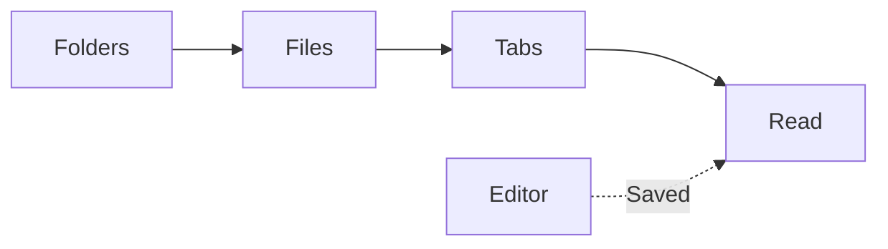

# Project handbook

Setup notes, architecture decisions, and diagrams — kept together in Markdown.

> [!NOTE]
> Click Edit to make a change and press Ctrl+S to save. Changes saved in another editor also appear automatically.

## A readable workspace

| Document | What you will find |
| --- | --- |
| README | Project overview and setup |
| Architecture | Components and design decisions |
| Notes | Ideas, checklists, and working notes |

## From folders to a document



## Code, without leaving your notes

```typescript
const folders = ['C:/projects', 'D:/notes'];

for (const folder of folders) {
  console.log(`Reading Markdown from ${folder}`);
}
```

## Math alongside the explanation

Inline equations such as $E = mc^2$ fit into a sentence. Longer expressions have room of their own:

$$
\sum_{i=1}^{n} i = \frac{n(n+1)}{2}
$$

## A short checklist

- [x] Add your project folders
- [x] Open the documents you need
- [x] Follow a diagram or copy a code sample
- [ ] Get back to your work

## Keep your place

Use the outline to jump between sections. **Source** switches to the Markdown text while keeping the reading position. Each open tab remembers its own position during the session.

Press **Ctrl+P** to find another file, or **Ctrl+F** to search this document.

## Write a quick note

Press **Ctrl+N** to create a Markdown file in an added folder. While editing, type `/` to choose a heading, list, table, code block, or another Markdown snippet.
