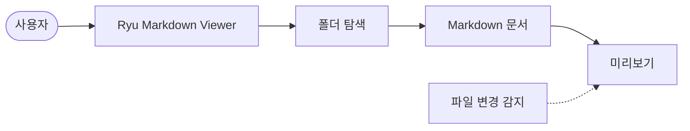
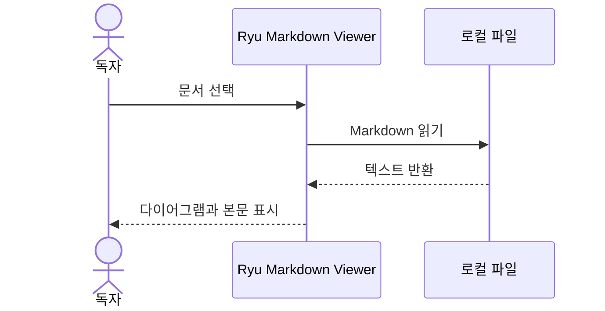
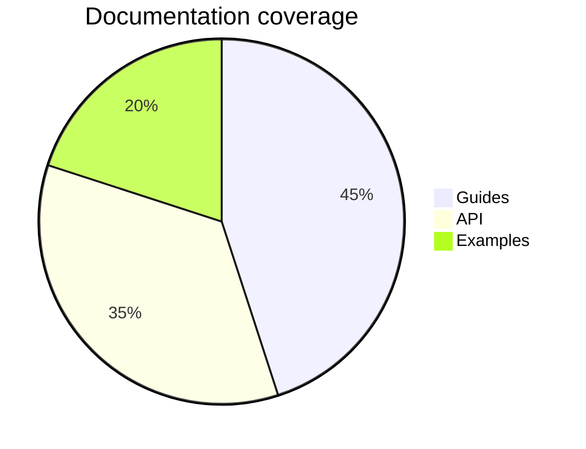

# Ryu Markdown Viewer · Markdown playground

표, 코드, 수식과 Mermaid 다이어그램의 표시를 확인하는 예제 문서입니다.

> [!NOTE]
> 이 문서를 에디터에서 수정하고 저장해 보세요. 화면이 자동으로 갱신됩니다.

## 프로젝트 구조

```text
my-project/
├── README.md
├── docs/
│   └── architecture.md
└── src/
```

## 시스템 흐름



## 요청 시퀀스



## 파이 차트



## 수식

$$
f(x) = \int_{-\infty}^{\infty} e^{-\pi t^2} e^{-2\pi ixt}\,dt
$$

확률의 합은 $\sum_{i=1}^{n} p_i = 1$입니다.

## 코드

```python
from pathlib import Path

for document in Path("./docs").rglob("*.md"):
    print(document.name)
```

## 진행 상황

- [x] Markdown 모으기
- [x] 다이어그램 표시하기
- [ ] 문서 읽기

| 항목 | 상태 | 비고 |
| --- | --- | --- |
| Markdown | 완료 | 표, 목록, 인용 |
| Mermaid | 완료 | 다양한 다이어그램 |
| 수식 | 완료 | KaTeX |

## 상대 링크와 이미지

[설계 문서 열기](./docs/architecture.md) · [설계 문서의 렌더링 절로 이동](./docs/architecture.md#렌더링)


<details>
<summary>접을 수 있는 HTML 영역</summary>

기본 HTML도 안전하게 표시합니다.

</details>

각주를 포함한 문서도 읽을 수 있습니다.[^example]

[^example]: 이 각주는 Markdown-it으로 렌더링합니다.
