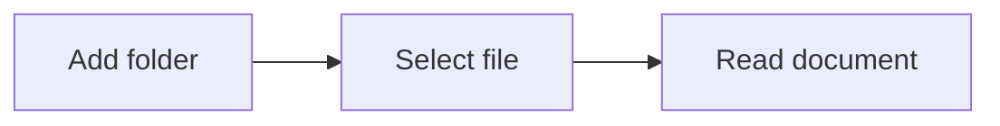

# Ryu Markdown Viewer guide

Edit Markdown with **Edit** and save with `Ctrl+S`. Create a new `.md` file with the folder’s new-file button or `Ctrl+N`. In the editor, type `/` for Markdown commands, keep typing to filter, and select with ↑/↓ and Enter/Tab or the mouse. Press Esc to dismiss.


## Edit and create documents

Unsaved edits stay in memory while the app is running. Closing a tab, removing a folder, or quitting asks whether to save them. Files changed externally are protected from accidental overwrites.

## Open documents

- **Add folder**: register a folder from the lower left. Its `.md` and `.markdown` files appear in the explorer.
- **Open file**: press `Ctrl+O` to open a document.
- **Find a file**: press `Ctrl+P` to search your added folders.

You can add multiple folders. Removing a folder from the workspace keeps its files.

## Read documents

Select a file in the explorer to open it in a tab. Use the outline to jump to a heading, or `Ctrl+F` to search the document. **Source** switches between Markdown source and preview.

Changes saved in another editor appear automatically. Use Refresh if the explorer needs updating.

## Diagrams

Mermaid code blocks render as diagrams. Use the expand button to inspect a larger view.



## Math and code

Inline math $E = mc^2$ and display equations are supported.

$$
\sum_{i=1}^{n} i = \frac{n(n+1)}{2}
$$

Code blocks include syntax highlighting and a copy button.

```typescript
const folders = ['C:/projects', 'D:/notes'];
```

## Keyboard shortcuts

| Shortcut | Action |
| --- | --- |
| Ctrl+N | New Markdown file |
| Ctrl+S | Save document |
| Ctrl+O | Open file |
| Ctrl+Shift+O | Add folder |
| Ctrl+P | Find a file |
| Ctrl+F | Find in document |
| Ctrl+B | Show / hide explorer |
| Ctrl+W | Close tab |
| Ctrl+＋ / Ctrl+－ | Zoom in / out |
| Ctrl+0 | Reset zoom |

## Settings

Open the gear at the lower left to choose English, 한국어, 简体中文, 繁體中文, or 日本語. The language changes immediately and is remembered after restarting. Your Markdown documents keep their original language.

The sun / moon button switches themes. Added folders, open tabs, theme, and zoom are restored on the next launch.
